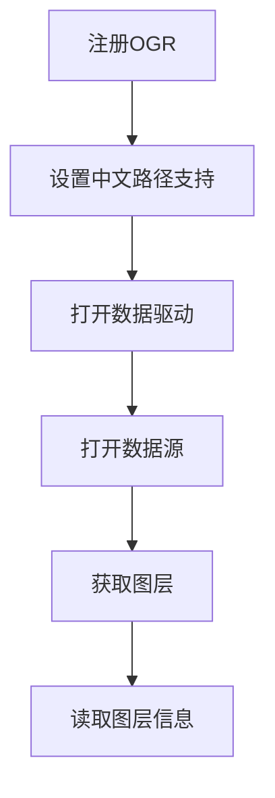
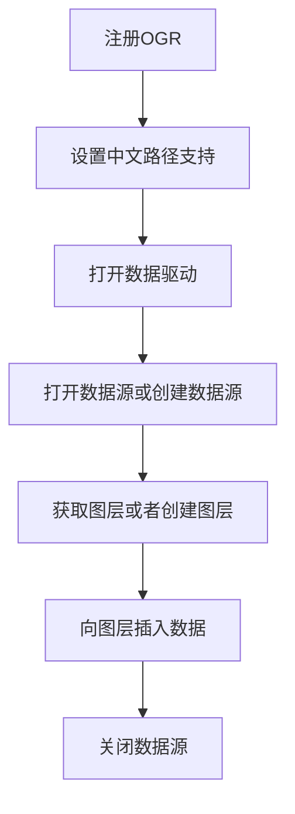
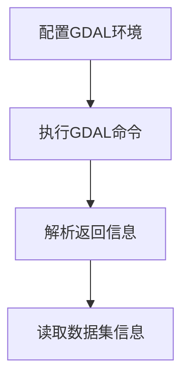

# FileGDB代码示例

FileGDB 是 Esri ArcGIS 的原生矢量数据格式。一个 `.gdb` 目录里可以放多个要素类、表、关系类和栅格目录，还带着拓扑、子类型、域这些 GIS 语义。格式本身不开源，桌面端要用 ArcGIS 打开，脚本和服务端则通常借 GDAL/OGR 访问：GDAL 提供 FileGDB 和 OpenFileGDB 两个驱动，前者调用 Esri 的 FileGDB API，读写都能做；后者是 GDAL 自己的实现，不依赖 ESRI 库。

这一页给出 Java 侧三个常用操作：按图层名读取要素、往已有或新建的 GDB 里写要素、用 `ogrinfo` 读取整个数据集的元信息。示例基于 GDAL 的 Java 绑定（`gdal.jar` 加本机 GDAL 动态库），另外用到 hutool 的工具类，换成 JDK 原生写法也不难。

运行前确认两件事：本机 GDAL 版本与 `gdal.jar` 一致，且 `java.library.path` 指向 GDAL 的 JNI 库。版本不一致时 `ogr.RegisterAll()` 往往直接抛 `UnsatisfiedLinkError`，这类错误先查版本，再查路径。


## 1. 读取FileGDB图层

### 1.1 实现思路

读取一个要素类的步骤是固定的：注册驱动、处理中文路径、按名称取驱动、打开数据源、取图层，最后遍历字段和要素。每一步都不能跳：驱动没注册，`GetDriverByName` 返回 null；数据源没打开，后面取图层会空指针。下面的流程图就是这条链路。




### 1.2 代码示例

这段代码把读取链路串了起来，重点看几个转接点：`RegisterAll()` 之后才能按名字拿到驱动；`Open()` 的第二个参数决定只读还是可写；图层对象拿到以后，字段定义从 `GetLayerDefn()` 取，要素则靠 `GetNextFeature()` 一条条往前推。


```Java

public Layer readGdbLayer(String driverName,String gdbPath,String layerName) {
        ogr.RegisterAll();
        gdal.SetConfigOption("GDAL_FILENAME_IS_UTF8", "YES");

        Driver driver = ogr.GetDriverByName(driverName);
        DataSource dataSource = driver.Open(gdbPath, 1);
        Layer layer = dataSource.GetLayerByName(layerName);

        for (int i = 0; i < layer.GetLayerDefn().GetFieldCount(); i++) {
            System.out.println(layer.GetLayerDefn().GetFieldDefn(i).GetName());
        }

        Feature feature = layer.GetNextFeature();
        while (feature != null) {
            for (int i = 0; i < feature.GetFieldCount(); i++) {
                System.out.println(feature.GetFieldDefnRef(i).GetName());
                System.out.println(feature.GetFieldAsString(i));
            }

            System.out.println(feature.GetGeometryRef().ExportToWkt());

            feature = layer.GetNextFeature();
        }

        return layer;
    }

```

代码里有几个容易踩的点：

- `ogr.RegisterAll()` 在进程启动时调一次就够了。重复调用没有副作用，但会遍历全部驱动，放在静态初始化里比每次读文件都调用更合适。
- `gdal.SetConfigOption("GDAL_FILENAME_IS_UTF8", "YES")` 针对 Windows 的中文路径。GDAL 默认按系统代码页解释文件名，开启后才按 UTF-8 处理；Linux 上一般不需要，设了也无害。
- `driver.Open(gdbPath, 1)` 第二个参数 0 是只读、1 是可写。只做读取时传 0 更稳，能避免后续代码误写数据。
- `GetNextFeature()` 每调一次取一条要素，取完返回 null。遍历过程中拿到的 Feature 对象在下一次取要素后可能被复用，需要长期保存的属性要立刻拷贝成自己的对象。
- 几何用 `ExportToWkt()` 转 WKT 输出。实际项目里更常见的做法是按图层坐标系转 GeoJSON，或直接写进业务模型。

字段分两类：`GetFieldDefn` 拿到的是字段定义（名称、类型、宽度），`feature.GetFieldAsString(i)` 是按索引取值。按索引取字段的前提是字段顺序与图层定义一致，跨数据源复制要素时这条不成立，应该按字段名取。

另外，FileGDB 的要素类可能带子类型和域，直接读出来的字段值不一定是界面里看到的显示值。需要完整语义时用 `ogrinfo -al -so` 或 QGIS 打开确认。

### 1.3 读取阶段的资源管理

GDAL Java 绑定不做垃圾回收层面的自动释放。`DataSource`、`Layer`、`Feature` 都持有本地指针，用完后要显式 `delete()`，或依赖对象池统一释放。只读场景下进程很快退出问题不大，长时间运行的服务里漏掉释放，文件句柄会一直涨。

文件句柄还有一个副作用：Windows 上只要 GDB 目录被进程持有，目录就删不掉、也改不了名。排查“文件被占用”时先看有没有未释放的 DataSource。

## 2. 写入FileGDB图层

### 2.1 实现思路

写入比读取多两步：数据源和图层都可能不存在，需要先建。GDB 里还可以把要素类放进要素数据集（Feature Dataset），这一步通过创建图层时的选项传进去。下面的流程把“打开或创建数据源”“获取或创建图层”都画了出来。




### 2.2 代码示例

下面的写法对“GDB 已存在/不存在”“图层已存在/不存在”都做了处理，可以直接当模板用。


```Java

public void writeGdbLayer(String driverName,String gdbPath,String featureDataset,String layerName,int wkid,String wkt) {
        ogr.RegisterAll();
        gdal.SetConfigOption("GDAL_FILENAME_IS_UTF8", "YES");

        Vector options = null;
        if (CharSequenceUtil.isNotBlank(featureDataset)) {
            options = new Vector();
            options.add("FEATURE_DATASET=" + featureDataset);
        }

        Driver driver = ogr.GetDriverByName(driverName);
        DataSource dataSource = driver.Open(gdbPath, 1);
        if (dataSource == null) {
            dataSource = driver.CreateDataSource(gdbPath);
        }

        Layer layer = dataSource.GetLayerByName(layerName);
        if (layer == null) {
            SpatialReference sr = new SpatialReference();
            sr.ImportFromEPSG(wkid);
            layer = dataSource.CreateLayer(layerName, sr,6, options);
        }

        FieldDefn fieldDefn = new FieldDefn("TEST", 4);
        layer.CreateField(fieldDefn);

        Feature feature = new Feature(layer.GetLayerDefn());
        feature.SetGeometry(ogr.CreateGeometryFromWkt(wkt));
        feature.SetField("TEST", "test");
        layer.CreateFeature(feature);
        
        dataSource.delete();
    }

```

代码末尾的 `dataSource.delete()` 是 GDAL Java 绑定里释放数据源的方式，等价于 C++ 的 `GDALClose`。写完不释放，轻则文件句柄占用，重则在 Windows 上删不掉 `.gdb` 目录。

参数含义如下：

| 参数 | 含义 | 说明 |
| --- | --- | --- |
| `driverName` | 驱动名 | 通常写 `FileGDB`；只读场景也可用 `OpenFileGDB` |
| `gdbPath` | `.gdb` 目录 | 目录不存在时 `CreateDataSource` 会新建 |
| `featureDataset` | 要素数据集名 | 为空表示直接建在 GDB 根下 |
| `layerName` | 要素类名 | 已存在时 `GetLayerByName` 直接复用 |
| `wkid` | 坐标系 EPSG 编号 | 如 4326、4490 |

### 2.3 写入时的注意事项

`FieldDefn("TEST", 4)` 里的 4 是 OGR 字段类型 `OFTInteger`，示例只建了一个整型字段。实际写入前要按业务字段逐个建 `FieldDefn`，类型和宽度与源数据对齐；`SetField` 类型不匹配时不会抛异常，只会静默失败或截断。

坐标系用 `SpatialReference.ImportFromEPSG(wkid)`。写入的 WKT 几何必须与图层坐标系一致：度与米混用不会报错，但数据会偏到地图外面，这种错误在属性表里完全看不出来。

还有一个常见坑是字段名长度。FileGDB 的字段名上限是 64 个字符，但第三方工具转写时经常按 10 个字符截断（Shapefile 的习惯），跨格式搬数据前先核对字段名。

## 3. 读取FileGDB数据集

### 3.1 实现思路

除了 Java API，也可以用命令行 `ogrinfo` 看数据集结构：加 `-json` 输出便于程序解析，加 `-al -so` 只输出图层摘要。这种方式不写 JNI 代码，适合放进运维脚本或健康检查。




### 3.2 代码示例

这段代码处理了 `ogrinfo` 输出可能带额外日志行的情况：先判断整体是否为 JSON，不是就截取第一个 `{` 到最后一个 `}` 之间的内容再解析。GDAL 某些构建版本会把警告或驱动信息打到 stdout，直接 `JSON.parse` 会失败。


```Java

public void readGdbDs(String gisPath){
        SystemPropsUtil.set("GDAL_FILENAME_IS_UTF8", "YES");
        SystemPropsUtil.set("SHAPE_ENCODING", "UTF-8");
        String output = RuntimeUtil.execForStr(StandardCharsets.UTF_8, "ogrinfo", "-json", gisPath);
        
        String jout = null;
        if (!JSONUtil.isTypeJSONObject(output)) {
            jout = output.substring(output.indexOf("{"));
        }

        if (!JSONUtil.isTypeJSONObject(jout)) {
            jout = output.substring(output.indexOf("{"), output.lastIndexOf("}") + 1);
        }

        JSONObject jsonObject = JSON.parseObject(jout);
        String rootGroup = jsonObject.getString("rootGroup");
        System.out.println(rootGroup);
    }

```

### 3.3 常见问题

- 打开数据源返回 null：先确认驱动名拼写，再确认 GDB 是 ArcGIS 10.x 之后的版本。9.x 的 Personal Geodatabase 是 Access 文件，不属于这个格式。
- 中文属性乱码：属性编码由 GDB 自身决定，OGR 一般能正确转换；通过外部工具转出的中间文件才需要单独设编码。
- 写入时报只读：`Open` 的第二个参数要传 1，或改用 `CreateDataSource` 新建数据源。
- 写入后 ArcGIS 打不开：FileGDB 对字段类型和域约束要求严格，先用 QGIS 或 `ogrinfo` 验证，再回到 ArcGIS 里确认。

### 3.4 小结

FileGDB 的读写骨架就是“注册驱动、设 UTF-8、打开数据源、取图层、遍历要素”。把释放数据源、按字段名取属性这两件事做对，大部分问题都能避开。

<!-- NAVIGATION -->

---

<div class="chapter-nav">
  <a href="https://znlgis.github.io/gis/basic/data/GeoJSON代码示例/" class="chapter-nav__prev">← 上一章</a>
  <a href="https://znlgis.github.io/gis/basic/data/" class="chapter-nav__dir">目录</a>
  <a href="https://znlgis.github.io/gis/basic/data/PostGIS数据库操作简介/" class="chapter-nav__next">下一章 →</a>
</div>

<!-- /NAVIGATION -->
