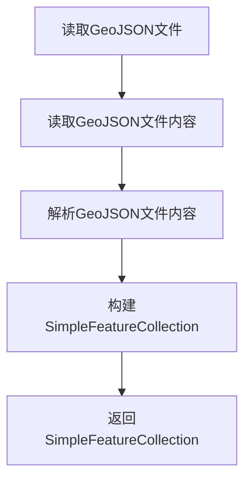
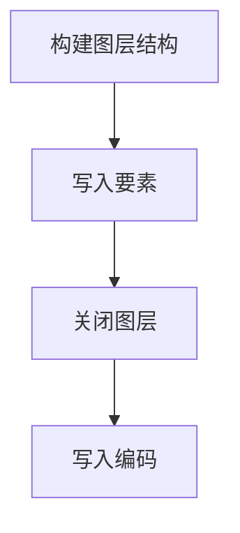

# GeoJSON代码示例

GeoJSON 是用 JSON 表达的矢量数据格式，标准是 RFC 7946。一个 FeatureCollection 里放 Feature，每个 Feature 带 geometry 和 properties；几何类型覆盖点、线、面及其多几何版本。格式文本可读、能被浏览器和大多数 GIS 库直接解析，是 Web 地图前后端交换矢量数据的默认选择。

标准规定坐标必须是 WGS84 经纬度（EPSG:4326），但不少工具会写出自定义 CRS 或省略坐标参考信息，读入时要自己判断。另一个现实问题是体积：同样的面数据，GeoJSON 通常比二进制格式大几倍，超过几十万要素就不适合整包传输。

下面的示例用 GeoTools 的 `GeometryJSON` 和 `FeatureJSON` 完成读写，适用于 Java 后端。


## 1. 读取GeoJSON文件

### 1.1 实现思路

读取的流程分四步：按文件实际编码读出字符串、解析出要素类型（schema）、创建可写的结果集合、流式读入每条要素。先解析 schema 再读要素，是因为 `ListFeatureCollection` 需要先有要素类型；流式接口则避免一次性把整个文档建成对象树。




### 1.2 代码示例

`GeometryJSON(16)` 里的 16 是坐标保留的小数位数，GeoJSON 默认按完整 double 输出，位数太多会让文件明显变大；16 位对经纬度已经足够。

`readFeatureCollectionSchema(geojsonString, true)` 的第二个参数表示严格模式，遇到不规范的字段类型会直接报错，调试阶段建议保持开启，能尽早发现数据问题。

`streamFeatureCollection` 返回的迭代器要放在 try-with-resources 里关闭，底层可能持有流或缓冲区。示例把结果收进 `ListFeatureCollection`，属于全量进内存的写法；数据量大时应该换成边读边处理，或者用 `FeatureJSON` 的分块接口。

读取前用了 `CharsetDetector.detect`。GeoJSON 标准要求 UTF-8，但国内数据常被转成 GBK，直接按 UTF-8 读会抛 `MalformedInputException`。检测不到时退回 UTF-8，并在日志里记录文件路径，方便回头修数据。


```Java

    public static SimpleFeatureCollection readGeojson(String geojsonPath){
        File file = new File(geojsonPath);
        Charset encoding = CharsetDetector.detect(file);
        String geojsonString = FileUtil.readString(file, encoding);

        GeometryJSON gjson = new GeometryJSON(16);
        FeatureJSON fjson = new FeatureJSON(gjson);

        try {
            SimpleFeatureType simpleFeatureType = fjson.readFeatureCollectionSchema(geojsonString, true);
            ListFeatureCollection featureCollection = new ListFeatureCollection(simpleFeatureType);
            try (FeatureIterator<SimpleFeature> features = fjson.streamFeatureCollection(geojsonString)) {
                while (features.hasNext()) {
                    featureCollection.add(features.next());
                }
            }

            return featureCollection;
        } catch (IOException e) {
            throw new RuntimeException(e);
        }
    }

```

写入阶段要注意两点：坐标参考系和输出精度。GeoJSON 约定用经纬度，若数据是投影坐标（如 CGCS2000 的 3 度带），写出去之前先转换，不要只改标签。

## 2. 写入GeoJSON文件

### 2.1 实现思路

写出时先把要素集合的 CRS 对齐到目标 EPSG，再交给 `FeatureJSON.toString` 序列化，最后按 UTF-8 写文件。如果跳过 CRS 对齐，GeoTools 可能不输出 `crs` 字段，读端就会按 WGS84 解释，位置全偏。




### 2.2 代码示例

`ForceCoordinateSystemFeatureResults` 只修改要素集合的 CRS 声明，不做坐标变换。第三参数决定强制范围，用之前最好确认数据本身已经是目标坐标系；如果数据还在别的坐标系，应该用 `ReprojectingFeatureCollection` 做真正的投影转换。这两个类名字接近，作用完全不同，是这一节最容易搞错的地方。

`fjson.toString(featureCollection)` 输出的是带缩进的文本，调试时好读，生产环境建议去掉缩进或改用流式 writer，能省不少带宽。


```Java

    public static void writeGeojson(String geojsonPath, SimpleFeatureCollection featureCollection,Integer wkid){
        GeometryJSON gjson = new GeometryJSON(16);
        FeatureJSON fjson = new FeatureJSON(gjson);
        
        try {
            CoordinateReferenceSystem crs = CRS.decode("EPSG:" + wkid, true);
            featureCollection = new ForceCoordinateSystemFeatureResults(featureCollection, crs, false);

            String geojsonString = fjson.toString(featureCollection);
            FileUtil.writeString(geojsonString, geojsonPath, "utf-8");
        } catch (Exception e) {
            throw new RuntimeException(e);
        }
    }

```

### 2.3 常见问题

- 中文变成问号：写文件时显式指定 UTF-8，读取端也要按 UTF-8 解码。
- 浏览器端显示位置偏移：多半是写了投影坐标但没带 `crs`，或带了 `crs` 而读端忽略它。统一转成 EPSG:4326 最省事。
- 文件过大导致前端卡死：先按图层或按范围切片，或者改用矢量瓦片（MVT）。GeoJSON 适合做交换和调试，不适合直接当海量数据的发布格式。
- 属性字段类型丢失：GeoJSON 只有字符串、数字、布尔和 null 四种属性类型，日期会退化成字符串，读回后要按业务规则转换。

### 2.4 小结

读写 GeoJSON 本身不复杂，难的是编码和坐标系这两个隐式约定。把“先定 CRS、再定编码、最后才解析”的顺序固定下来，跨系统交换数据的坑会少一大半。

<!-- NAVIGATION -->

---

<div class="chapter-nav">
  <a href="https://znlgis.github.io/gis/basic/data/Shapefile代码示例/" class="chapter-nav__prev">← 上一章</a>
  <a href="https://znlgis.github.io/gis/basic/data/" class="chapter-nav__dir">目录</a>
  <a href="https://znlgis.github.io/gis/basic/data/FileGDB代码示例/" class="chapter-nav__next">下一章 →</a>
</div>

<!-- /NAVIGATION -->
