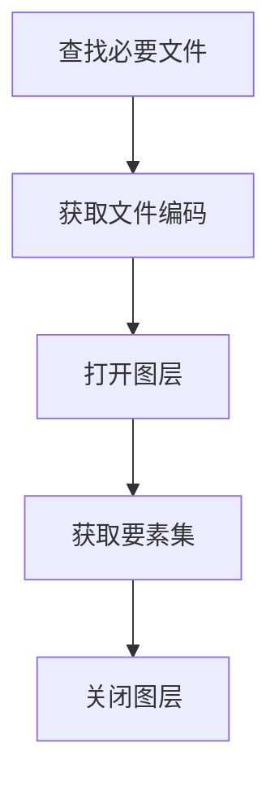
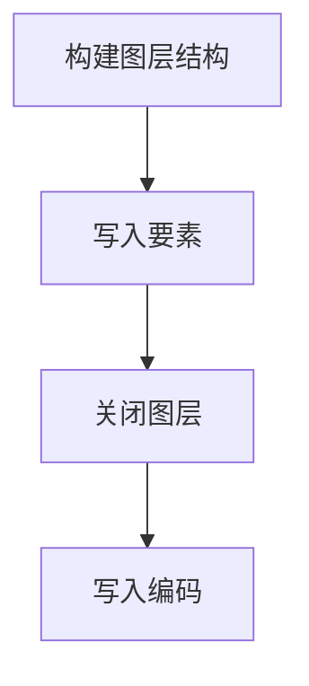

# Shapefile代码示例

Shapefile 是 ESRI 在上世纪 90 年代定义的矢量格式，至今仍是数据交换里最常见的格式之一。它其实不是单个文件，而是一组同名文件的集合：`.shp` 存几何、`.shx` 存索引、`.dbf` 存属性表，`.prj` 存坐标系，`.cpg` 指定属性编码。少一个，很多软件就打不开或读不全。

格式限制很明确：一个 Shapefile 只能存一种几何类型（点、线或面），字段名最长 10 个字符，单个文件不能超过 2GB，属性表不支持字段级约束。做小范围交换够用，做全量库表设计就不合适了。

下面用 GeoTools 的 `ShapefileDataStore` 演示读写，编码处理是重点——国内 Shapefile 里 GBK 和 UTF-8 混杂的情况非常普遍。


## 1. 读取Shapefile文件

### 1.1 实现思路

读 Shapefile 之前先做完整性检查：`.shp`、`.shx`、`.dbf`、`.prj` 四个文件缺一不可。少了 `.shx` 有的库还能扫描读取，但性能会明显下降；少了 `.prj` 就只能靠人工判断坐标系。

编码判断走三步：优先读 `.cpg` 文件里的编码名；没有 `.cpg` 时看 `.dbf` 头第 29 字节的语言驱动标记，0x4D 对应 GBK；两处都没有就按 UTF-8 处理。这个顺序与 QGIS、ArcGIS 的实际行为基本一致。




### 1.2 代码示例

`ShapefileDataStore` 的构造函数接收一个 URL，这里用 `file.toURI().toURL()` 转过去，比直接拼 `file://` 字符串更稳，路径里有中文或空格也不会出错。

`setCharset` 必须在取要素之前调用，底层读 `.dbf` 时按这个编码解码字段值；调用晚了不会报错，但中文已经读成乱码了。

`getTypeNames()[0]` 取第一个图层名。Shapefile 只有一个图层，取索引 0 即可。`source.getFeatures()` 返回的是延迟加载的要素集合，真正的 I/O 发生在遍历时，所以 `dispose()` 之后不一定能继续读——示例先取 `source` 再 `dispose` 是一种常见写法，稳妥起见应该把读取放进 try-with-resources，读完再释放。

`.dbf` 头第 29 字节的判断来自 DBF 规范里的 Language Driver ID（LDID）。0x4D 表示简体中文 GBK，但很多导出工具并不维护这个字节，所以它只能当兜底，不能当唯一依据。


```Java

    public static SimpleFeatureCollection readShp(String shpPath) {
        List<String> bys = CollUtil.newArrayList(".shp",".shx",".dbf",".prj");
        for (String by : bys) {
            String path = CharSequenceUtil.replaceLast(shpPath, ".shp", by,true);
            if(!FileUtil.exist(path)){
                throw new RuntimeException(by+"类型的文件不存在");
            }
        }

        Charset shpCharset = null;
        String cpgPath = CharSequenceUtil.replaceLast(shpPath, ".shp", ".cpg",true);
        if(FileUtil.exist(cpgPath)){
            File cpgFile = FileUtil.file(cpgPath);
            Charset cpgCharset = CharsetDetector.detect(cpgFile);
            String cpgString = FileUtil.readString(cpgFile, cpgCharset);
            try {
                shpCharset = Charset.forName(cpgString.trim());
            } catch (Exception e) {
                throw new RuntimeException("CPG文件保存的编码格式错误");
            }
        }
        
        if (shpCharset == null) {
            String dbfPath = CharSequenceUtil.replaceLast(shpPath, ".shp", ".dbf",true);
            if(FileUtil.exist(dbfPath)){
                byte[] bs = FileUtil.readBytes(dbfPath);
                if (bs != null && bs.length >= 30) {
                    byte b = bs[29];
                    if (b == 0x4d) {
                        shpCharset = Charset.forName("GBK");
                    }
                }
            }
        }

        if(shpCharset == null){
            shpCharset = StandardCharsets.UTF_8;
        }
        
        try {
            File file = new File(shpPath);
            ShapefileDataStore shpDataStore = new ShapefileDataStore(file.toURI().toURL());
            shpDataStore.setCharset(shpCharset);
            String typeName = shpDataStore.getTypeNames()[0];
            SimpleFeatureSource source = shpDataStore.getFeatureSource(typeName);
            shpDataStore.dispose();
            return source.getFeatures();
        } catch (IOException e) {
            throw new RuntimeException(e);
        }
    }

```

[Shapefile文件编码参考文档](https://kikitamap.com/2015/12/21/TroubleshootingShapefile/)

写入时同样要处理编码，示例统一按 UTF-8 写，并额外生成 `.cpg`，这样 QGIS、ArcGIS 打开时能识别编码，不会再把中文显示成乱码。

## 2. 写入Shapefile文件

### 2.1 实现思路

新建数据源用 `ShapefileDataStoreFactory.createNewDataStore`，传入目标 URL；然后用源要素集合的 schema 建表结构，再逐条追加要素。注意 `createSchema` 会根据 schema 生成 `.shp/.shx/.dbf/.prj`，字段名超过 10 个字符会被截断，建 schema 之前最好先检查一遍。




### 2.2 代码示例

写入循环里有个细节：`writer.hasNext()` 在这里的作用是推进到下一个可写要素，返回值不用判断；真正写数据靠 `writer.next()` 拿到空要素，填完几何和属性后调 `writer.write()`。

属性复制时跳过了几何类型的字段，因为几何已经通过 `setDefaultGeometry` 单独设置。其他字段按名称逐个拷贝，不使用索引，避免源、目标 schema 顺序不一致时写错列。

写完后关 `writer`、`dispose` 数据源，再补写 `.cpg`。顺序不能反：`.cpg` 要在数据源关闭后才能安全写，否则部分平台会锁住目录。


```Java

    public static void writeShp(String shpPath, SimpleFeatureCollection featureCollection){
        try {
            File shapeFile = new File(shpPath);
            Map<String, Serializable> params = new HashMap<>();
            params.put(ShapefileDataStoreFactory.URLP.key, shapeFile.toURI().toURL());

            ShapefileDataStore ds = (ShapefileDataStore) new ShapefileDataStoreFactory().createNewDataStore(params);
            SimpleFeatureType featureType = featureCollection.getSchema();
            ds.createSchema(featureType);
            Charset charset = StandardCharsets.UTF_8;
            ds.setCharset(charset);

            String typeName = ds.getTypeNames()[0];
            FeatureWriter<SimpleFeatureType, SimpleFeature> writer = ds.getFeatureWriterAppend(typeName, Transaction.AUTO_COMMIT);

            try (FeatureIterator<SimpleFeature> features = featureCollection.features()) {
                while (features.hasNext()) {
                    SimpleFeature feature = features.next();
                    writer.hasNext();
                    SimpleFeature writefeature = writer.next();
                    writefeature.setDefaultGeometry(feature.getDefaultGeometry());

                    for (PropertyDescriptor d : featureType.getDescriptors()) {
                        if (!(feature.getAttribute(d.getName()) instanceof Geometry)) {
                            Name name = d.getName();
                            Object value = feature.getAttribute(name);
                            writefeature.setAttribute(name, value);
                        }
                    }

                    writer.write();
                }
            }

            writer.close();
            ds.dispose();

            String cpgPath = shpPath.substring(0, shpPath.lastIndexOf(".")) + ".cpg";
            FileUtil.writeString("UTF-8", cpgPath, StandardCharsets.UTF_8);
        }catch (Exception e){
            throw new RuntimeException(e);
        }
    }

```


## 3. Shapefile代码操作的原则

- 默认使用UTF-8编码格式，根据实际情况处理编码问题
- 读写前先校验四个必需文件是否齐全，缺失时给出明确报错，而不是让底层抛 IOException
- 字段名超过 10 个字符时提前重命名并记录映射关系，不要指望导出后再回头找
- 频繁写入或数据量接近 2GB 时，改用 GeoPackage、FileGDB 这类容器格式

### 3.1 常见问题

- 属性表中文乱码：先看 `.cpg` 内容是否正确，再看看是否被其他工具改写过 `.dbf`。乱码一旦写入磁盘就不可逆，只能从原始数据重导。
- 打开后属性表是空的：`.dbf` 文件缺失或被单独删除。Shapefile 的属性与几何是两个文件，只拷 `.shp` 是常见错误。
- 找不到坐标系：`.prj` 缺失。可以用 `ogrinfo` 或 QGIS 手工指定，但坐标系一旦判断错，后续叠加分析全错。
- 要素数量对不上：`.shx` 与 `.shp` 不一致，通常是写入过程中断留下的损坏文件，需要从备份恢复。

<!-- NAVIGATION -->

---

<div class="chapter-nav">
  <a href="https://znlgis.github.io/gis/basic/data/图层级GIS数据格式概述/" class="chapter-nav__prev">← 上一章</a>
  <a href="https://znlgis.github.io/gis/basic/data/" class="chapter-nav__dir">目录</a>
  <a href="https://znlgis.github.io/gis/basic/data/GeoJSON代码示例/" class="chapter-nav__next">下一章 →</a>
</div>

<!-- /NAVIGATION -->
